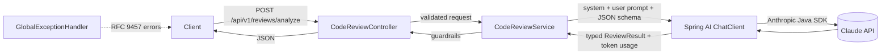
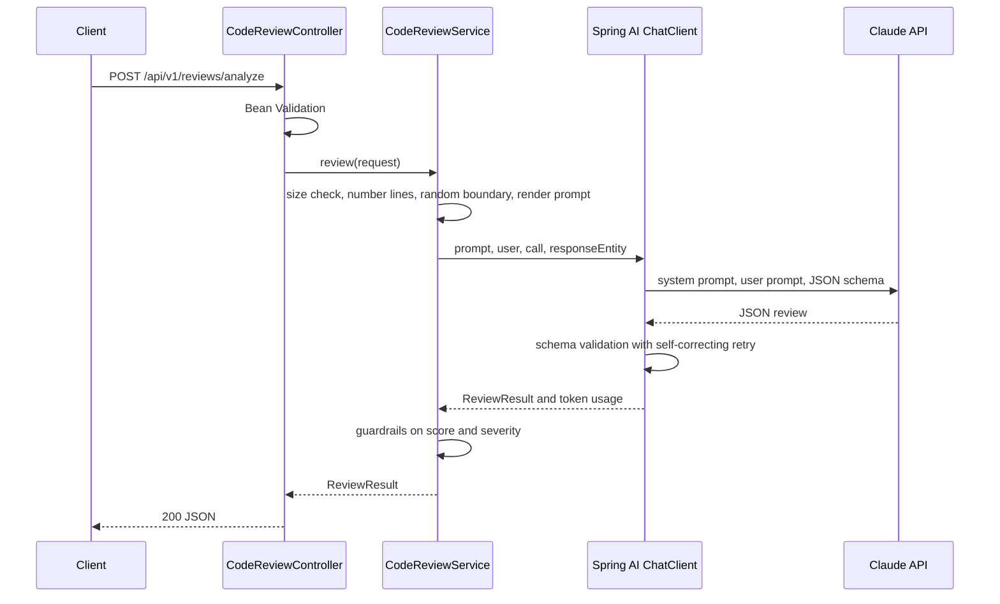

# Automated-Code-Review-Agent
Automated code review and static analysis microservice built with Java, Spring Boot, and Spring AI (Anthropic Claude API). Evaluates code snippets and Git diffs for OWASP security vulnerabilities, performance bottlenecks, and code smells using structured JSON outputs.

# Automated Code Review Agent

A stateless Spring Boot service that sends source code or a git diff to Claude and returns a **validated, structured review**: security findings with CWE ids, performance issues and code smells, and a refactored version of the code.


## What it does

`POST /api/v1/reviews/analyze` accepts a code snippet or a git diff plus a language name. It returns JSON with:

- `overallScore` (1 to 10)
- `summary`
- `securityVulnerabilities`: severity, CWE id, line reference, description, remediation
- `performanceAndCodeSmells`: issue, impact, suggested fix
- `refactoredCode`

The response is mapped to a Java record, so downstream code gets a typed object instead of free text.

## Architecture



### Request lifecycle



## Tech stack

- Java 21, Spring Boot 4.1, Spring Framework 7
- Spring AI 2.0 (Anthropic module, `ChatClient`, structured output)
- Claude Sonnet via the Anthropic API (model is configurable)
- JUnit and Mockito for tests, Docker for packaging
- No database: the service is stateless

## Quick start

**Prerequisites:** JDK 21 and an Anthropic API key from the [Anthropic Console](https://console.anthropic.com/) (the account needs credits).

```bash
export ANTHROPIC_API_KEY=sk-ant-...        # PowerShell: $env:ANTHROPIC_API_KEY = "sk-ant-..."
mvn spring-boot:run
```

Check that it is up, then send a sample:

```bash
curl http://localhost:8080/actuator/health
curl -s http://localhost:8080/api/v1/reviews/analyze \
  -H "Content-Type: application/json" \
  --data-binary @samples/payloads/sql-injection.json
```

### Docker

A multi-stage `Dockerfile` is included (build with Maven, run on a JRE as a non-root user). It has not been build-tested yet.

```bash
docker build -t code-review-agent .
docker run --rm -p 8080:8080 -e ANTHROPIC_API_KEY code-review-agent
```

The key is passed at runtime and is never stored in the image.

## API

`POST /api/v1/reviews/analyze`

| Field | Required | Notes |
|---|---|---|
| `language` | yes | 1 to 30 characters: letters, digits, `+ # . -` and spaces |
| `codeSnippet` | one of | Source code to review |
| `gitDiff` | one of | A unified diff to review |

Provide **exactly one** of `codeSnippet` or `gitDiff`. Input is capped at 20,000 characters by default.

### Sample response (abridged)

From a real run on a one-line SQL string-concatenation snippet. Long fields are shortened with `...`.

```json
{
  "overallScore": 2,
  "summary": "...",
  "securityVulnerabilities": [
    {
      "severity": "CRITICAL",
      "cweId": "CWE-89",
      "lineReference": "1",
      "description": "The variable 'name' is concatenated directly into the SQL string. An attacker who controls it can break out of the quotes and change the query, ...",
      "remediation": "Use a PreparedStatement with bound parameters: ..."
    }
  ],
  "performanceAndCodeSmells": [ "..." ],
  "refactoredCode": "..."
}
```

### Errors

All errors are RFC 9457 `application/problem+json` responses with a stable `code` field. Provider details are logged server-side and never returned to the caller.

| HTTP | `code` | Meaning |
|---|---|---|
| 400 | `VALIDATION_FAILED` | Missing or invalid fields (an `errors` map is included) |
| 400 | `MALFORMED_REQUEST` | Body is missing or not valid JSON |
| 413 | `INPUT_TOO_LARGE` | Input exceeds `review.max-input-chars` |
| 429 | `UPSTREAM_RATE_LIMITED` | The AI provider is rate limiting |
| 502 | `MODEL_OUTPUT_INVALID` | The response could not be turned into a valid review |
| 502 | `UPSTREAM_AUTH_ERROR` / `UPSTREAM_ERROR` | Provider rejected the credentials or the request |
| 503 | `UPSTREAM_UNAVAILABLE` | Provider temporarily unavailable |
| 504 | `UPSTREAM_TIMEOUT` | Provider took too long |
| 500 | `INTERNAL_ERROR` | Unexpected failure |

## Configuration

| Setting | Default | Purpose |
|---|---|---|
| `ANTHROPIC_API_KEY` | none (required) | API key; the app refuses to start without it |
| `ANTHROPIC_MODEL` | `claude-sonnet-5-5` | Claude model id |
| `spring.ai.anthropic.max-retries` | `3` | SDK-level retries for transient failures |
| `spring.ai.anthropic.timeout` | `120s` | Per-request timeout |
| `spring.ai.anthropic.chat.max-tokens` | `8192` | Output token cap |
| `review.max-input-chars` | `20000` | Reject oversized input before spending tokens |
| `review.structured-output` | `native` | `native` (provider-enforced schema) or `prompt` (schema in the prompt) |
| `review.validate-schema` | `true` | Re-ask the model when its JSON fails schema validation |

## Design decisions

| Decision | Why | Trade-off |
|---|---|---|
| Provider-native structured output by default, prompt-based as a switchable fallback | The provider enforces the schema, so malformed JSON cannot be emitted; the prompt path works on models without native support | Native support varies by model and schema features |
| Self-correcting schema validation | Malformed output is fed back to the model and retried | Extra calls (and tokens) only when output is invalid |
| Line numbers added server-side | Models count lines unreliably, so we number them deterministically | Slightly larger prompts |
| Random per-request boundary token around the code | Reduces prompt-injection risk from comments or strings inside the reviewed code | A mitigation, not a guarantee |
| Guardrails in code (score range, severity-based score cap) | The scoring rubric is enforced even if the model drifts | Clamps model output, which is logged |
| Errors translated to stable codes | Callers get predictable errors and no provider internals | Mapping must be kept in sync with provider behavior |
| No `temperature` setting | The current Sonnet model rejects it (observed as an HTTP 400). Consistency comes from the rubric, closed enums and the schema | Not tunable by sampling |
| Virtual threads | Model calls are slow I/O and should not hold platform threads | Requires Java 21 |
| Stateless, reviewed code is never logged | Simple to scale and avoids retaining user code | No history or audit trail |

## Testing

```bash
mvn test
```

13 unit tests run **without an API key and without network access**: the `ChatClient` is mocked. They cover prompt construction (line numbering, brace-safe rendering, diff handling), input limits, error translation, score guardrails, request validation and schema generation.

These tests cover the code around the model, not the model's review quality. I also ran a small manual consistency check: 5 runs per structured-output mode on one sample. The score and the security finding were identical in all 10 runs, while the number of minor code-smell findings varied between 0 and 1. That is a quick check, not a benchmark.

## Samples

`samples/` contains deliberately flawed code (SQL injection, an unclosed resource, an O(n^2) loop) and ready-made JSON payloads in `samples/payloads/`. These files are never compiled.

## Limitations and next steps

- No authentication or rate limiting. Do not expose it publicly as is.
- Reviewed code is sent to the Anthropic API. Do not submit secrets or confidential code unless your policy allows it.
- Reviews are advisory. The model can miss issues or report false ones.
- The size limit counts characters, not tokens.
- Next steps: rate limiting and a circuit breaker (for example Resilience4j), an evaluation set with expected findings, a GitHub pull-request integration, and authentication.

## Project structure

```text
src/main/java/com/codereview/agent/
├── config/       ChatClient bean and typed properties
├── controller/   REST endpoint
├── dto/          Request, response and nested records
├── exception/    Domain exception and global error handler
└── service/      Prompt rendering, Claude call, guardrails
src/main/resources/
├── application.yml
└── prompts/      system-code-review.st, user-code-review.st
samples/          Flawed inputs and JSON payloads
```